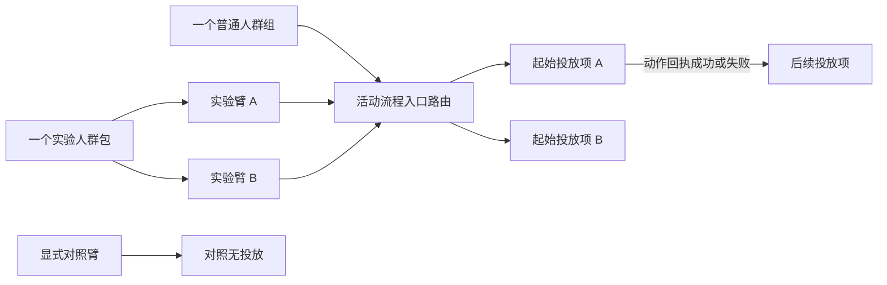

# 活动受众入口与流程路由模型设计

## 背景

活动演示目前允许一个活动含多个入口人群，并允许每个投放项再选一份人群。当前 core 的 `TreatmentSpec.Who` 和 `CampaignSpec.Flow` 可选设计也延续了这种关系。用户确认：活动只有一个入口受众；实验臂决定不同起始投放路径；进入流程后由动作回执边推进后续投放项。

浏览器演示也不符合该关系：跨境召回样例把普通组与实验臂分别挂在不同投放项，另一个样例把多个受众当作活动入口；编辑表单按投放项选择人群。

## 目标

让活动成为一个业务入口与一张活动流程：活动选择一个普通人群组或一个实验人群包；流程按该人群或包内实验臂选择一个或多个起始投放项；后续投放只由回执边决定，并继续使用回执携带的 UID。

## 领域模型

- `Campaign` 持有唯一入口受众选择。受众选择是封闭联合类型：单个已构建普通 `Group`，或一个已发布 `Bundle`；不能同时传两者，也不能传任意组切片。
- `Campaign` 必须持有一个 `Flow`。没有活动边的单投放项活动仍是带一个节点的活动流程。
- `Flow` 显式声明入口路由：普通组对应一条入口分区；实验包必须逐臂对应一条路由。每条路由可以列出一个或多个入口候选投放项。对照臂使用显式 `Control`（对照无投放），不可用“漏掉一条路由”表达；这不是长期留置型 Holdout。
- 每个 `Treatment` 只持有动作调用与展示位配置，不持有人群。活动入口选择哪个组负责起始枚举；入口路由负责选节点；后续 `EdgeOnReceipt` 负责推进同一个 UID。
- `EdgeParallel` 保持既有含义：标示并行图关系，不替代入口路由，也不执行转发。
- 活动级放量继续是活动门槛，不替换活动入口选择，也不改它的单调分桶行为。
- 交互式展示决策仍可用决策表条件在同一活动入口人群内选一个展示投放项。普通组入口路由可将同一展示位的多个投放项列为候选，决策表按顺序选择其中一个；不在该入口路由中的节点不能被决策服务暴露。活动入口先决定资格，决策表再选起始节点；决策表不再作为另一个入口受众。

## 构造与执行约束

- core 构造活动时要求有效受众选择、活动流程和至少一个投放项。
- 单人群入口须至少配置一个起始候选投放项；实验包每个臂必须显式配置一条路由，或显式选择对照无投放。实验臂路由的投放项集合不得重叠，避免同一个节点含糊地代表不同实验臂；一个臂可映射多个并行/决策候选节点。
- 每个投放项必须是至少一条入口路由中的候选起点，或是至少一条有效回执边的目标；同槽候选展示项可再由决策表选择。receipt edge 条件仍由来源动作声明；仍拒绝循环、未知节点与边冲突。
- 枚举运行只枚举 Flow 中绑定的入口组；一个组的推送起始项按既有并行行为运行。实时展示决策先判定该 UID 属于活动入口组，再只在该组的起始候选节点及其决策表内选择。回执边目标不做目标人群枚举，沿用上游 UID、key 与 placements。
- 服务端演示数据可保留不完整草稿状态供用户逐步编辑；本地演练在入口臂覆盖完整、流程合法后才能启动。core 可构造的活动始终是完整活动。

## API 与演示

- `/api/v1` 的活动 JSON 用一个 `audience` 代替 `audienceRefs[]`，其类型为 `group` 或 `bundle`。
- `treatments[]` 删除 `audienceRef`；`activityFlow` 增加显式 `entries[]`。普通组入口路由引用该 group；bundle 入口路由逐臂引用 arm group，并标出 `start` 或 `control`。
- 活动受众通过带 `expectedAudience` 的写操作并发保护；当受众改变时，服务端在同一锁内清空不再适用的旧入口路由并保留回执边。之后通过带 `expectedEntries` 和 `expectedEdges` 的流程写操作配置新入口。中间状态只作为未完成草稿，不能开始本地演练；任何已保存入口都必须属于当前所选受众。
- 3D SVG 沙盘的绘制、视角与演练行为继续复用；只调整其数据绑定与入口连线。选中一个活动级入口后，普通组连到起始项；实验包则展示各臂到起始项的分支；之后的边只表示回执。
- 当前本机服务为演示数据，无真实触达、生产存储或跨进程保证。
- 该 V1 合同是破坏性调整。用户已在本会话确认原地更新、不增加 V2；仓库中的唯一演示客户端同步更新，新增对外变更记录。

## 关键取舍

1. **在 Campaign 放一份组切片**：它仍允许多个互不相关的活动入口，类型无法兑现“一个活动只有一个受众”。否决。
2. **保留 Treatment.Who，并强校验彼此属于同一 bundle**：可保持现有 API，但仍让入口身份散落在投放项里，无法清楚表示一个普通组下的多个并行步骤，也会继续把回执目标误读成人群枚举。否决。
3. **活动级选择 + Flow 入口路由**：唯一入口可明确是一个组或一个实验包，实验臂的开始路径与后续回执路径分开建模；采用。

## 风险与回退

- 核心模型与活动管理 API 同步改动，期间编译错误可以暴露遗漏；核心领域回归与浏览器回归固定入口、实时决策候选范围、回执 UID 及对照臂边界。
- V1 旧 JSON 字段不再接受。此 API 随 PR #77 尚未合并；已确认的唯一调用方是仓库演示客户端，随本分支一起迁移。回退采用反向提交，不涉及已持久化数据迁移。
- 真实持久化与真实渠道执行不在本次范围。
