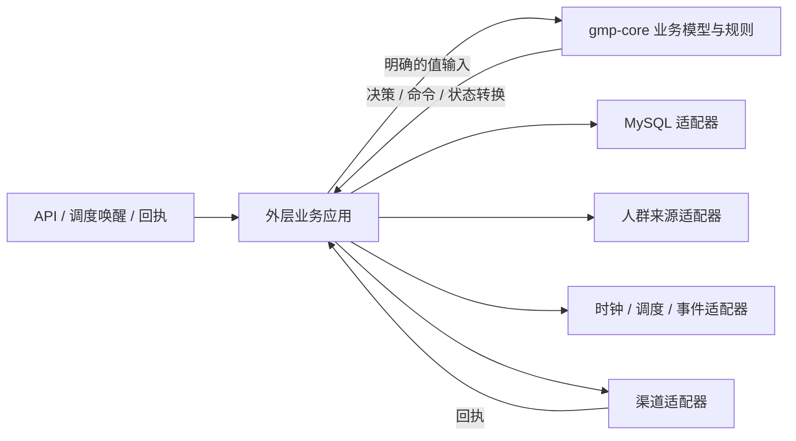

# 纯业务 Core 与外层 MySQL 持久化设计

> 状态：Draft，供 Issue #88 评审。用户已确认 Core 不持有存储、CRUD 由外层业务应用负责；持久化实体、API 迁移和运行态保证仍待确认。本设计不表示实现已完成或可以接入生产。

## 意图

把 `gmp-core` 收敛为与具体存储和外部系统无关的业务模型内核。活动定义、人群规则、实验分组和触达流程由 Core 表达和计算；外层业务应用负责读取真实事实、持久化状态、执行 CRUD 和编排外部作用。MySQL 是外层的一种适配器，不成为 Core 的能力或依赖。

用户关心的是基于真实业务结构执行 CRUD，而不是把当前演示 Store 原样映射成数据库。当前 `management` 使用自己的管理模型，尚未依赖 `gmp-core`，因此仅替换其 Store 会留下两套业务模型。

## 目标

- Core 不包含内存 Store、持久化 Store、数据库端口、SQL / HTTP / 调度 / 渠道 I/O。
- Core 用明确输入和输出表达业务决策、约束及状态转换；值对象可以描述当前状态，但不保存状态。
- 外层应用使用 Core 类型和规则完成 CRUD、状态加载 / 提交、事务与流程编排。
- MySQL、人群来源、时钟、事件投递、调度和渠道发送均通过外层端口及适配器接入。
- 保留稳定分组、活动内回执分支、execution key、幂等重试等既有业务语义。

## 非目标

- 本设计阶段不接数据库、不建表、不写迁移、不修改 API 或执行代码。
- 不直接接入真实客户名单、券系统核销、触达渠道或生产数据。
- 不替尚未裁定的业务事实（人群来源、指标口径、券是否使用）定义默认含义。
- 不把 Docker 演示改称生产部署，也不在 Core 中引入完整的工作流引擎。

## 考虑过的方案

| 方案 | 做法 | 取舍 |
|---|---|---|
| **A. 纯 Core + 外层应用编排（推荐，用户已确认方向）** | Core 只表达模型、规则和转换；应用层定义 CRUD / repository 等端口，基础设施层实现 MySQL 与其他适配器 | 边界最清晰，Core 可独立验证；应用层要负责原子写入、并发、重试与流程持久化 |
| B. Core 定义 Store 接口，内存实现和 MySQL 实现都在外部 | Core 仍面向 Store 抽象，具体实现留在外层 | 依赖方向可控，但储存概念和测试适配器仍是 Core 设计的一部分，不符合“Core 不应有任何存储”的明确边界 |
| C. 直接把 `management.Store` 换为 MySQL | 保持现有管理模型，只替换底层 map | 改动最小，但管理模型仍与 Core 分离，不能证明真实 CRUD 使用核心业务规则 |

选择 A。Go 通过组合、函数和接口协作，不采用类继承。接口由需要它的外层应用定义；Core 不定义 repository / storage interface。

## 分层职责

### `gmp-core`

- 定义业务值、定义对象、状态、约束和校验。
- 对传入的人群事实、活动定义、实验定义、既有执行状态和事件作确定性决策。
- 输出分组结果、执行意图、拒绝原因或下一状态，不执行数据库写入、发送、等待或定时。
- 时间作为显式输入；事件与回执作为显式输入。相同输入应产生相同业务结果。
- 染色记录、执行状态和回执可以是 Core 中的业务值类型；Core 不读取或保存这些值。

### 外层业务应用

- 对 API、调度唤醒或回执请求提供用例入口。
- 通过自身定义的端口读取当前定义、染色记录、执行状态和人群事实，再将它们作为普通值传给 Core。
- 根据 Core 输出提交数据库事务、生成稳定幂等键、协调并发、保存事件发件箱记录、处理重试及调用适配器。
- 选择和映射 Core 领域对象与外部 REST DTO；不能维护第二套互相矛盾的业务规则。

### 基础设施适配器

- MySQL：连接、schema、迁移、repository 实现、事务和数据库约束。
- 人群来源：从实际来源查询候选人及属性；实际成员事实归其来源，不由 Core 持有。
- 时钟 / 调度 / 事件投递：由可替换适配器提供；Core 接收显式时间和事件。
- 渠道：执行 Core 产出的触达意图，使用同一执行的幂等键，并把回执交回应用层。

箭头描述运行时调用。编译依赖方向是：应用层依赖 Core；适配器依赖应用层定义的接口和必要的 Core 值类型；Core 不依赖应用层或适配器。组合根负责构造并连接各实现。

## 流程保证的边界

Core 可以保证输入合法时的业务规则、路由选择和状态转换正确；它不能单独保证进程崩溃后继续运行、跨实例唯一写入或外部渠道只产生一次副作用。系统级流程保证由外层应用和适配器共同完成。

建议的调用顺序：

1. 应用层读取活动 / 投放项 / 实验定义、人群候选与所需运行状态。
2. 将所需上下文（包括当前时间与收到的回执）显式传给 Core。
3. Core 返回拒绝原因、分组 / 路由决策、拟写状态和待执行意图。
4. 应用层在事务内保存新状态和待发送意图；跨数据库与渠道的可靠投递由外层发件箱 / 重试策略承接。
5. 渠道适配器以稳定幂等键发送；回执先由应用层保存，再作为输入交给 Core 决定后续边或终态。

此流程是架构目标，不代表当前 API、数据库事务或真实渠道已经实现。究竟使用发件箱、队列或其他投递方案，须结合部署与故障恢复要求在实施设计中定稿。

## 实验染色的纯 Core 表达

系统级染色有持久状态，但 Core 的分配决策仍可保持无存储：

- 应用层按 `(AssignmentID, AssignmentKey)` 查询既有染色记录。
- Core 接收定义、键及可选既有记录；存在记录时返回该记录的份号，不存在时返回确定性计算结果和拟创建的 `ColoringRecord`。
- 应用层以唯一约束和事务完成首次记录写入；遇到并发冲突时读取获胜记录并重新调用 / 完成决策，不能采用各自内存结果。
- `ColoringRecord` 是业务值，不是存储实现；repository、唯一索引和 insert-or-read 行为都在 Core 外。

上述写入和并发行为是保护历史实验结论的高风险契约。实际键构成、并发算法和数据库唯一约束仍需进入实施任务卡与契约测试。

## 持久化范围与迁移原则

MySQL 表结构必须围绕数据所有者、生命周期、唯一性和原子性设计，不得仅把每个 Go 结构体机械地映射成一张表。

候选状态分为：业务配置（人群规则 / 引用、活动、投放项、流程、实验定义）与运行状态（染色、执行、回执、待投递意图）。哪些进入首期持久化、哪些由外部来源负责、是否分阶段交付尚未裁定，实施前必须逐项确认。尤其是：

- Core 中的人群定义不等于真实用户名单；名单查询归外部来源适配器。
- “券已发”不等于“券已使用”；核销事实仍由券系统持有，当前不能据此实现未使用人群。
- 活动流程实验节点目前仍是浏览器草稿，是否纳入首期业务 API 与持久化尚未裁定。
- 当前演示服务没有生产数据库数据。浏览器本地受众 / 实验数据与进程内活动种子不得未经用户确认就自动回填到新 schema。
- 连接配置必须来自显式环境 / 密钥管理来源，缺少必填项、迁移失败或 schema 不匹配时明确失败，不切换到内存 Store。

数据库版本、Go 驱动、迁移工具、配置项名称、实体范围和回滚策略均留待实施任务卡确认；设计阶段不编造默认值或连接地址。

## 测试与证据

- Core 单元 / 场景回归通过显式输入和输出验证业务语义，不依赖 Core 内的内存 Store。
- 外层应用测试可在其模块使用受控 test double；不得把 test double 作为 Core 的生产实现。
- MySQL 适配器以真实 MySQL 集成验证 CRUD、事务、迁移、并发唯一性及失败原子性；不能只用 map 替代数据库契约证据。
- 跨层业务规则回归仍应覆盖已确认业务场景；本设计建议 Core 场景测试只测试纯业务语义，应用 / MySQL 集成测试放在外层模块。根 `AGENTS.md` 当前规定跨子项目业务场景落在 `gmp-core/scenarios/`，实现前须核对该规则是否需要拆分「纯 Core 场景」与「外层集成场景」。
- 结构化日志只记录操作类型、结果、耗时及可安全关联的技术 ID；不记录 DSN 密码、令牌、客户名单或业务载荷。

## 实施前待确认

- 首期需要持久化的准确实体清单及其数据所有者、生命周期和回滚 / 清理规则。
- `management` 是改造成基于 Core 的应用服务、拆分为应用层和适配器，还是保留为演示客户端；现有 `/api/v1` 契约是否兼容。
- Core 人群定义与外部名单来源的契约；真实数据是查询使用还是需要平台复制，需由业务确认。
- 执行态、染色、回执和 outbox 是否进入同一首期；各自事务边界、并发唯一键和幂等键组成。
- 活动流程实验节点、未使用券事实、实验指标等当前未完成语义是否排除在本次之外。
- 根 `AGENTS.md` 的场景测试位置规则是否需要配合调整。
- MySQL 版本 / 驱动 / 迁移工具、连接配置来源、部署拓扑和测试环境。

在这些问题明确并经人工确认前，本设计可用于评审边界，但不授权猜测生产表结构、迁移历史数据或接入真实系统。
